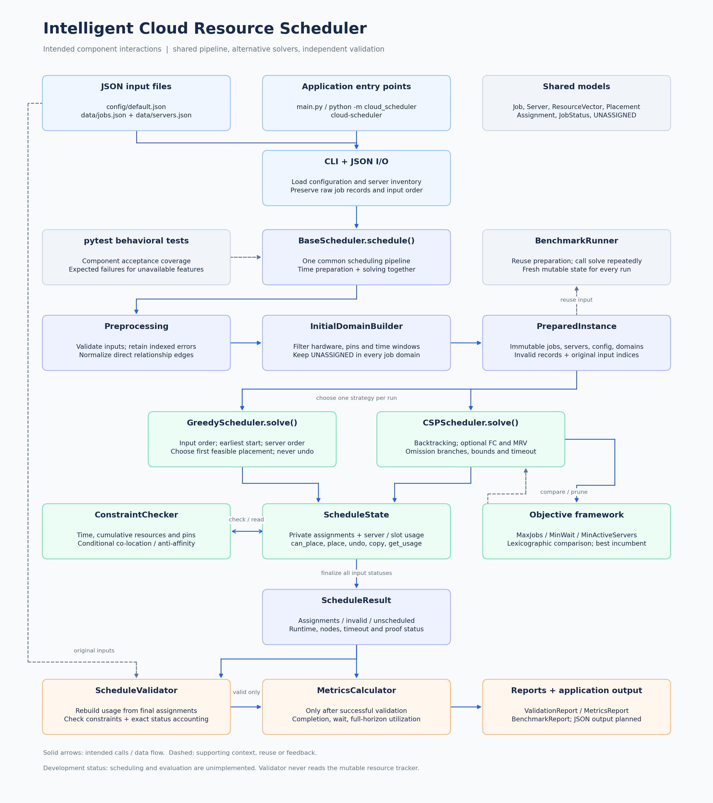
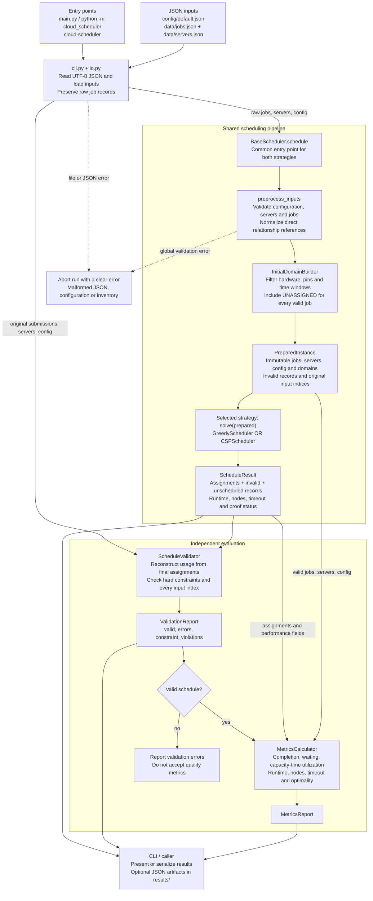
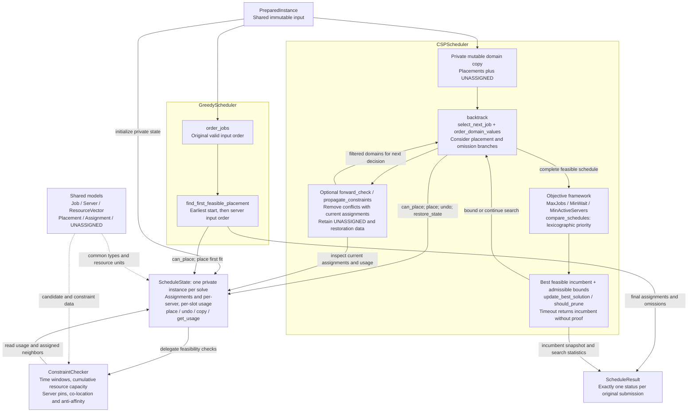
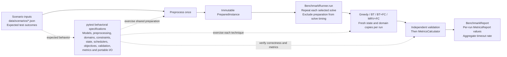

# Component interactions

Open the [PNG image](diagrams/component-interactions.png) directly, or use the
[SVG image](diagrams/component-interactions.svg) for sharper zooming and printing.
The image displays in a standard Markdown preview without a Mermaid extension.

These diagrams describe the component interfaces and planned execution flow.
Scheduling, preprocessing, constraint checking, optimization and evaluation are
not yet implemented; their interfaces raise `NotImplementedError`.

The detailed Mermaid diagrams below provide additional views and editable text
source. Rendering those blocks requires Mermaid support. Both image formats can
be opened on Windows and Ubuntu.

## From input files to an evaluated schedule

Malformed individual jobs become indexed `InvalidJob` records and remain in the
final accounting. Valid jobs with no feasible placement become `UnscheduledJob`
records. A global configuration or inventory error aborts the run.

Evaluation is a separate step after `schedule()` returns. The current CLI
does not yet connect evaluation or output serialization; those connections above
show the intended application flow.

## Inside the selected solver

The Greedy and CSP paths are alternatives. Each run creates its own mutable state;
they share interfaces and input contracts, rather than a live resource tracker.
Greedy never undoes earlier decisions. CSP must restore assignments, resource
usage and domain removals exactly when leaving a branch.

`ConstraintChecker` reads state without changing it. `ScheduleState.place()` checks
feasibility before changing usage; failed placement is atomic. Relationships apply
only when both directly related jobs are scheduled. An omission consumes no
resources and remains a valid decision even when no real placements survive.

`ScheduleValidator` deliberately sits outside this interaction: it rebuilds usage
from final assignments and never reads the solver's resource tracker. Optional
backjumping and MAC remain unavailable until their representations are designed.

## Benchmark reuse and test coverage

The benchmark path calls `solve(prepared)` directly rather than repeating
`schedule()` and preprocessing. The benchmark implementation must retain original
submission context for independent validation, including malformed records;
`PreparedInstance` currently contains normalized jobs and errors rather than all
original raw payloads, so that context must be passed or retained when wiring the
runner. Only independently validated runs contribute accepted metrics. Expected
scenario counts define expected behavior; performance results require measured runs.

Tests for unavailable features use strict `xfail` limited to
`NotImplementedError`. See [the development roadmap](IMPLEMENTATION_PLAN.md) for
implementation dependencies and acceptance criteria.
